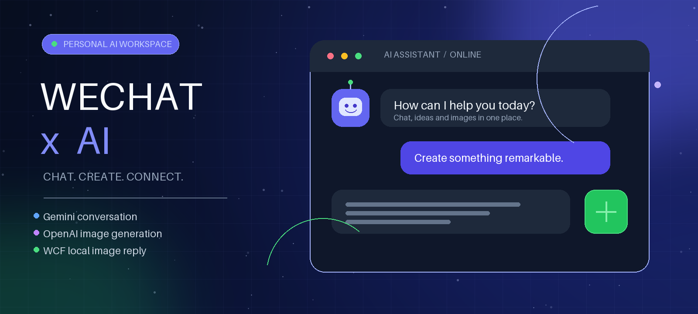
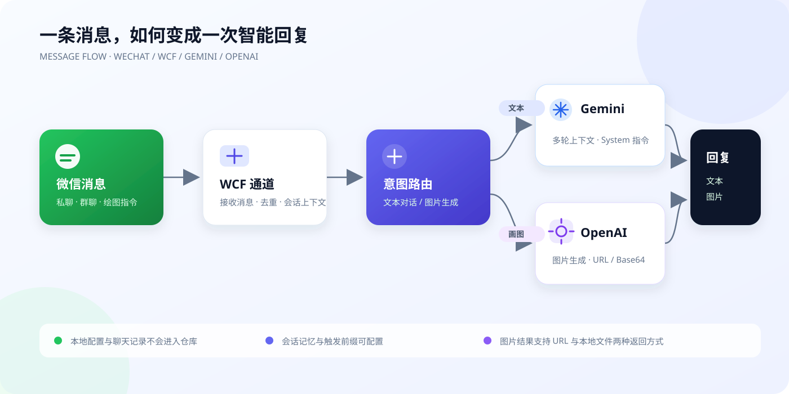

<div align="center">
  

  # weixin_ChatBot

  **基于 Gemini 与 OpenAI 的 Windows 微信 AI 聊天机器人**

  [](https://www.python.org/)
  [](https://ai.google.dev/)
  [](https://platform.openai.com/docs/guides/images)
  [](LICENSE)
</div>

## 项目简介

这是我在 [chatgpt-on-wechat](https://github.com/zhayujie/chatgpt-on-wechat) 1.7.6 基础上维护的个人定制版。项目通过 **WeChatFerry（WCF）** 接收和回复 Windows 微信消息，使用 **Gemini** 完成多轮文本对话，并在收到绘图指令时调用 **OpenAI 图片接口**。

本仓库重点记录以下个人改动：

- **新版 Gemini SDK**：从旧的 `google-generativeai` 迁移到 `google-genai`。
- **独立的系统指令**：将 `system` 消息传入 `system_instruction`，不再与普通用户消息混合。
- **多轮会话转换**：将历史消息转换为 Gemini 的 `user` / `model` 内容结构。
- **两种图片结果**：同时支持图片 URL 和 Base64 响应；Base64 会解码为本地 PNG。
- **微信本地图片回复**：通过 `wcf.send_image()` 将生成的图片直接发送到当前私聊或群聊。
- **更适合公开的默认值**：忽略真实配置、聊天数据、日志和临时图片，避免把本机运行环境一并提交。

> 本项目用于个人学习与技术研究。WCF 涉及第三方微信进程交互，请提前了解账号、平台规则及合规风险，并优先使用测试账号。

## 功能演示与架构



一次典型请求的处理流程如下：

1. WCF 接收微信私聊或群聊消息，并进行消息去重。
2. 消息通道检查触发前缀、群聊白名单和会话状态。
3. 普通文本进入 Gemini；带有绘图前缀的请求进入 OpenAI 图片接口。
4. 文本直接回复；图片根据接口返回类型，以 URL 或本地文件形式处理。
5. WCF 将文本或图片发送回原来的聊天窗口。

## 环境与准备

| 项目 | 说明 |
| --- | --- |
| 操作系统 | Windows；WCF 通道不支持脱离 Windows 微信单独运行 |
| Python | 本项目在 Python 3.10 环境中整理和检查 |
| 微信 | 需要与所安装 `wcferry` 版本兼容的 Windows 微信客户端 |
| Gemini | 一个可访问所选模型的 Gemini API Key |
| OpenAI | 仅绘图功能需要；可使用兼容 OpenAI Images API 的服务 |
| 网络 | 根据所选模型服务的可访问性自行配置网络或 API 地址 |

请先登录 Windows 微信，再启动机器人。不要在未确认兼容性的情况下升级微信或 WCF。

## 快速开始

### 1. 克隆代码

```bash
git clone https://github.com/ArcadiaE/weixin_ChatBot.git
cd weixin_ChatBot
```

### 2. 创建虚拟环境

以下命令适用于 Windows 命令提示符：

```bat
py -3.10 -m venv .venv
.venv\Scripts\activate
python -m pip install --upgrade pip
```

### 3. 安装依赖

当前“Gemini 对话 + OpenAI 绘图 + WCF 微信”组合可先安装最小依赖：

```bat
python -m pip install -r requirements.txt
python -m pip install google-genai wcferry
```

如需语音、插件或其他通道，再安装完整可选依赖：

```bat
python -m pip install -r requirements-optional.txt
```

### 4. 创建本地配置

```bat
copy config-template.json config.json
```

`config.json` 已被 `.gitignore` 排除。下面是与本定制版相关的脱敏示例；请根据自己的账号和聊天场景修改：

```json
{
  "channel_type": "wcf",
  "model": "gemini-3.1-pro-preview",
  "gemini_api_key": "YOUR_GEMINI_API_KEY",
  "open_ai_api_key": "YOUR_OPENAI_API_KEY",
  "open_ai_api_base": "https://api.openai.com/v1",
  "text_to_image": "gpt-image-2",
  "proxy": "",
  "single_chat_prefix": ["bot", "@bot"],
  "single_chat_reply_prefix": "",
  "group_chat_prefix": ["@bot", "/ai"],
  "group_name_white_list": ["你的测试群"],
  "image_create_prefix": ["画"],
  "speech_recognition": false,
  "expires_in_seconds": 3600,
  "character_desc": "你是一个乐于助人的 AI 助手，请使用清晰、简洁的语言回答。"
}
```

配置注意事项：

- `model` 和 `text_to_image` 必须是你的 API 账号实际可调用的模型名称；示例名称不代表所有账号均已开通。
- 使用兼容的图片 API 时，将 `open_ai_api_base` 替换为对应服务的 OpenAI 兼容地址。
- `group_name_white_list` 只列允许自动回复的群；不要使用真实隐私群名做公开演示。
- `expires_in_seconds` 控制会话空闲后的过期时间，单位是秒。
- 其他模型、语音和插件参数见 `config.py` 与 `config-template.json`。

### 5. 启动

确认微信已登录后运行：

```bat
python app.py
```

停止服务前可按 `Ctrl+C`。程序会在运行目录生成日志及运行数据，这些文件默认不会被 Git 跟踪。

## 如何使用

假设采用上面的示例配置：

| 场景 | 示例 | 结果 |
| --- | --- | --- |
| 私聊文本 | `bot 帮我整理今天的学习计划` | Gemini 返回文本 |
| 群聊文本 | `@bot 总结刚才的讨论` | 仅在白名单群内响应 |
| 斜杠指令 | `/ai 推荐三本科幻小说` | 按群聊前缀触发 |
| 私聊绘图 | `bot 画一座漂浮在云海上的未来城市` | 生成图片并发回微信 |
| 群聊绘图 | `@bot 画一只戴着宇航头盔的猫` | 生成图片并发回当前群 |

如果不需要私聊触发词，可以将 `single_chat_prefix` 设为 `[""]`；这会让所有符合条件的私聊文本进入机器人，请谨慎使用。

## 关键实现

| 文件 | 作用 |
| --- | --- |
| `bot/gemini/google_gemini_bot.py` | Gemini 会话、系统指令、消息格式转换与安全设置 |
| `bot/openai/open_ai_image.py` | 图片接口调用，兼容 URL / Base64 响应 |
| `bot/openai/open_ai_bot.py` | 根据图片结果选择 URL 或本地文件回复类型 |
| `channel/chat_channel.py` | 私聊、群聊、绘图前缀识别及会话上下文处理 |
| `channel/wechat/wcf_channel.py` | WCF 消息接收、文本回复与本地图片发送 |
| `config-template.json` | 不含真实密钥的配置模板 |

## 故障排查

### `ModuleNotFoundError: No module named 'google.genai'`

当前代码使用新版 SDK，请执行 `python -m pip install google-genai`。旧的 `google-generativeai` 包不能替代它。

### WCF 无法连接或收不到消息

检查 Windows 微信是否已登录，以及微信版本是否与 `wcferry` 兼容。还应确认终端与微信由同一 Windows 用户运行，并查看运行日志中的具体异常。

### 微信收到消息但机器人不回复

依次检查私聊前缀、群聊前缀、`group_name_white_list`、消息是否由机器人自己发出，以及对应 API Key 和模型名称是否有效。

### 图片生成成功但微信未收到

确认接口返回中包含 `url` 或 `b64_json`。Base64 图片会暂存为运行目录下的 `tmp_image.png`，再由 WCF 发送；请检查程序是否有写入权限，以及 WCF 是否支持当前图片路径。

### 提示模型不存在或无权限

将 `model` / `text_to_image` 改为你的账号已开放的名称。模型可用性、配额与计费由对应服务提供商决定。

## 隐私与安全

- **不要提交 `config.json`**：真实 API Key 只能保存在本地配置或安全的密钥管理工具中。
- **不要公开日志和用户数据**：`*.log`、`logs/`、`*.pkl`、`tmp_image.png` 均已加入忽略规则。
- **定期检查依赖与权限**：仅安装可信来源的依赖，并限制机器人可访问的群聊和插件。
- **密钥一旦泄露立即吊销**：删除公开文件并不能让已经泄露的密钥恢复安全。
- 自动回复内容应由使用者审核；请勿用于骚扰、欺诈、绕过平台限制或其他违法违规行为。

## 致谢与许可证

感谢原项目 [zhayujie/chatgpt-on-wechat](https://github.com/zhayujie/chatgpt-on-wechat) 及其贡献者提供基础框架，也感谢 [WeChatFerry](https://github.com/lich0821/WeChatFerry) 项目提供 WCF 能力。

本仓库保留原项目的 [MIT License](LICENSE)。个人修改与文档由 **ArcadiaE** 维护。
